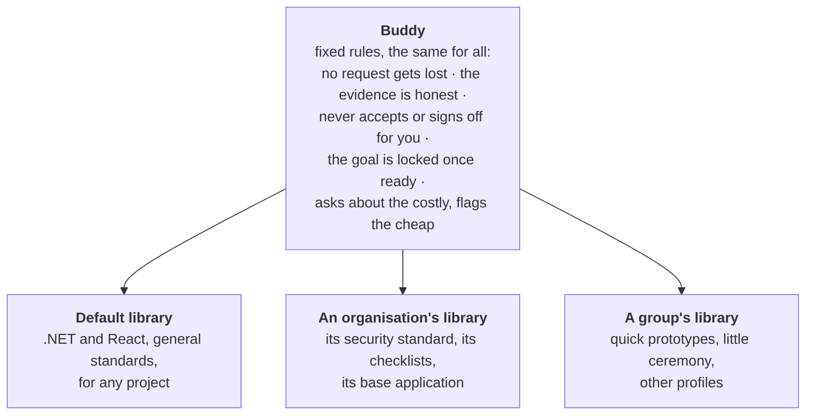
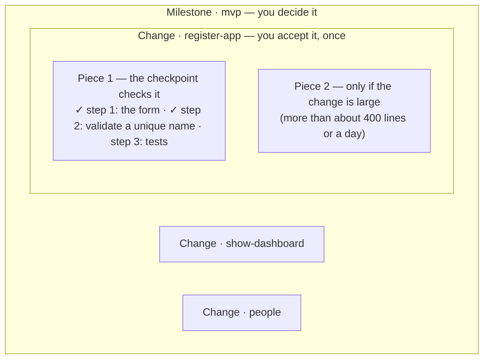
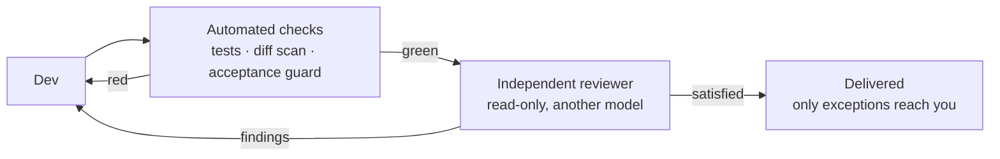

# Buddy, explained for a Product Owner

*The Product Owner's companion. You bring the judgement; Buddy handles the rest.*

Buddy is a plugin for [Claude Code](https://claude.com/claude-code) and [Antigravity](https://antigravity.google) that helps you build and maintain software that delivers real value to your business, without waste. He asks you first about what only you know, lets automated checks and an independent reviewer verify the work, and brings you only the decisions that are yours to make.

He never loses track of what you ask for: every request ends up built, explicitly excluded or openly deferred. You spend your time only on what needs you, without wondering whether the work is moving or whether it is the right work.

This page is for someone who is not (only) a developer. To install him, go to the [README](../README.md); for the details of every step, the [developer's guide](guide/README.md).

## What a question from Buddy looks like

> **Q1 of 2 · book-appointment · blocking**
> A customer books a slot that someone else grabbed that same minute. What should happen?
>
> - a) Accept the second booking and let the barber sort it out. *Cost: two customers at the same time.*
> - b) Tell them, and offer the nearest free slots. *Cost: one more screen. **Recommended.***
> - c) Hold the slot for five minutes while they confirm. *Cost: slots tied up by people who never confirm.*
>
> If you say "your call", I go with b) and record it as a delegated decision. While this question is open, anything that depends on it waits; everything else carries on.

Business words, options, what each costs, a recommendation and a default. Cheap choices he makes and tells you about; costly ones always come to you.

## What changes for you

| | |
| :-- | :-- |
| **You talk business, not code** | Buddy asks what only you know, in your own words. You never type his commands: he runs them. |
| **Work moves while you are away** | You answer one round of questions and can walk away. Buddy builds one piece after another without waiting for you, and interrupts only for something he truly cannot decide without you. |
| **You trust it without reviewing everything** | No one grades their own work: automated checks and an independent reviewer verify it, and only the exceptions reach you. If you ever remove Buddy, your project keeps everything it knows, in markdown and git. |

## Why it works

AI agents build fast. The hard part is getting them to build the right thing. Before building Buddy we measured what makes agent-driven development go well, and tried frameworks heavy on process. What separated good results from bad ones was neither the AI model nor long specifications.

- **Human input decides the outcome.** The same task went from 43 to 46 of 46 passing checks once a person answered the business questions. Spec-driven engines cost 1.5 to 5.6 times as much for the same quality. *(Our own experiments, October 2026.)*
- **Ceremony cannot cost the same for every change.** In one earlier framework, a six-line fix dragged in about 2,100 words of documents and seven commits. In another, verification ended up eating as much as 95% of the effort. Buddy scales the process to the risk of each change. *(Audits of earlier frameworks.)*
- **Left alone, an agent overbuilds and grades its own work.** Given a written context, the share of code nobody asked for rose from 20% to 48%. That is why Buddy measures overreach with a program instead of trusting an instruction. *(Our own experiment.)*

## Built to adapt: the library

Buddy does not impose a way of building. The stack, the security standard, the questions, the checklists and how much ceremony is needed all come from a **library**, a git repository of each organisation, or of each team within it. Whatever an organisation puts in its library weighs only on its own process, never on Buddy or anyone else.

Each one fills the same slots: questions, steps, standards, checklists. The same Buddy serves a business unit working under a strict standard and another that prototypes quickly. To write one, see the [library guide](../core/LIBRARY-GUIDE.md).

## If you come from Scrum

Buddy calls you by your role, Product Owner, and keeps the shape of the Scrum cycle: from a backlog of requests to an increment you review. What changes is who does each part, and that there is no fixed timebox: the inner loop lasts as long as each change takes, and Buddy does not wait for one change to finish before starting the next. You review when you are back.

| Scrum | In Buddy |
| :-- | :-- |
| Product Owner | **You.** You decide what gets built, answer the costly questions and accept the work. |
| Scrum Master | **Buddy, partly:** he facilitates, protects the process and never decides for you. |
| Development team | **Dev**, who builds, and an independent reviewer who did not write the code. |
| Product backlog | **The map of requests:** each one with its destination, MoSCoW priority and dependencies. |
| Backlog item | **A change,** with acceptance criteria and what it leaves out. |
| Increment | **A milestone:** something valuable that works on its own. It closes when its changes are accepted, not on a date. |
| Sprint planning | **The milestone card:** what Buddy will build, his open questions and his assumptions. Work starts only after you have seen it and given the go-ahead. |
| Definition of Done | The change's criteria met, a green checkpoint, and the full suite passing on the current code. |
| Sprint review | **The milestone review:** a complete script for trying every criterion, and your acceptance of each change. |
| Retrospective | `buddy feedback`: whatever slowed you down on a real project reaches Buddy's maintainers. |
| Metrics | `buddy minutes`: how many times each change asked you something and how long work waited for you. |
| Daily | Not needed: `board` and `digest` show where everything stands whenever you check. |

## How the work is split

Four sizes of work, and only two of them need you. A PRD becomes one or more milestones. Each milestone has its changes, which are built in pieces and steps. You discuss and accept milestones and changes; pieces and steps are left to Buddy and Dev unless something goes off track.

Everything inside runs without needing you as long as it stays clean.

## The whole journey

From an empty folder to an accepted milestone. Each phase says what you tell Buddy and what he does.

1. **Install Buddy** in the project folder, once per project (see the [README](../README.md#a-first-start)). Your project loses nothing if you later remove or update him: what he knows lives in its markdown files and in git, not in the plugin.
2. **Say hello** and what you want: *"I want to build an inventory of the company's applications."* The session already is Buddy; he replies in your language.
3. **The project starts out healthy.** He shows the library's profiles and where the repository will live, and creates the project with its template, standards and CI. If the folder already has a project, he does not copy anything over your code: he only adds his own files.
4. **Hand over what you have**, now or at any time: a PRD in `docs/inputs/`, an HTML prototype in `docs/inputs/prototype/`. He reads them, never changes them. If they change halfway, he brings in what changed without inflating the change already underway.
5. **Only an idea?** He offers to [discover the product](guide/discovery.md) with you: research with a source for every finding, interviews, a brief you confirm line by line, the flows, wireframes and a prototype tested with real people.
6. **Confirm the business.** He drafts the business context from your PRD: who it is for, what would be expensive to get wrong, what would be cheap. Every line stays *assumed* until you confirm it; the risk lines are confirmed before anything is built.
7. **Confirm the prototype, line by line.** It is the clearest way to say what you want. Buddy summarises each screen and flow, a program checks that his evidence really is in the prototype, a usability audit runs, and you confirm. It becomes your experience contract.
8. **Review the map of requests.** Every PRD requirement and every screen becomes a request with a destination: covered by a change, excluded, deferred or waiting on an answer. Nothing is forgotten, and what has no destination shows up on the board.
9. **Decide the milestone and answer the costly questions.** He proposes two or three ways to split the work into deliveries of value, each with what the business gets and what it costs. Then he opens the changes of the first milestone, with criteria (vague ones come back as a testable proposal) and exclusions, and asks **one round of questions**, only about what is expensive to change later: the data model, money, security, public contracts, running costs. He also lists what he will assume (five at most) so you can correct it early.
10. **Buddy builds; you can walk away.** He hands each change to Dev, who builds it to the standards and the prototype screens it covers. Before doing anything on his own he tells you what, why, and that typing "stop" halts him. Every reply ends with one line saying what he needs from you: 🔴 blocked, 🟡 your input, 🟢 nothing.
11. **The checkpoint checks every piece** (below). Anything clean needs nothing from you.
12. **Review the milestone and accept, change by change.** Accepting never holds up the work: delivered changes wait for you while Buddy moves on. At the end you get a review script: what was promised and delivered, the order to try things in, and for each change how to try it and what the checks found. You accept a change, send it back with what you saw, or log what you noticed as a new request.
13. **Integrate.** The branch reaches main through a pull request, and deployment is your call too. Buddy never merges on his own.

Along the way, whenever you like:

- **See how it is going.** *"How are we doing?"* gives you the board: what waits for you, what is being built now, what comes next. It is also a page that refreshes itself in your browser, in Spanish or English, on a phone or a wide screen, light or dark. The optional panel beside the conversation shows the same in short, with a button for each thing waiting for you.
- **Fix small things without ceremony.** Not everything is a change. For a typo, a dependency bump or a screen tweak, just ask: Buddy codes it with you in the same conversation (*vibe mode*), the standards still apply, and `buddy settle` runs the tests afterwards. If it turns out to change something specified, he says so and proposes a change.
- **Tell him what slowed you down.** He logs it as one line for Buddy's maintainers.

## The checkpoint: no one grades their own work

Each piece is judged on its own commits. The reviewer gets exactly what Dev got, and has to open the files that carry risk.

| Check | What it does |
| :-- | :-- |
| **Project tests** | The same command CI runs. It is stopped if it hangs. |
| **Diff scan** | Deleted or skipped tests, weakened assertions, silenced checks, protected files touched. |
| **Acceptance guard** | No commit of the piece changed the state or the acceptance of a record. |
| **Independent reviewer** | A read-only agent that gets the criteria, the exclusions, the standards, the context and the screens. It examines every existing test the change edited and marks each decision nobody specified as costly or not; only you can downgrade a costly one. |
| **Prototype deviations** | What Dev reported as different from the screens; you rule on each one when you accept. |
| **Full suite** | Before you accept, the whole suite passes on the current code. One run covers every acceptance for two days. |

Each line of evidence says *passed*, *failed*, *not run* or *not applicable*, and anything that did not run is never shown as passed. After three unresolved rounds on one piece, you decide. Before every commit, a plugin hook checks the message and scans for secrets.

## What sets Buddy apart

| | An agent alone | Specification frameworks | Process-heavy frameworks | **Buddy** |
| :-- | :-- | :-- | :-- | :-- |
| **Who asks** | Asks little, or guesses | Templates the team fills in | Gates on technical artefacts | Only about what is costly, in your terms, in one round |
| **Who checks** | The same agent | Whoever happens to review | Many checks on their own machinery | Automated checks and a reviewer who did not write the code |
| **Ceremony** | None | The same for every change | Grew until it swamped the work | Per milestone and per change, in proportion to risk |
| **What you see** | The code | Specifications | Checklists and sign-offs | The exceptions, what was assumed on your behalf, and requests with no destination |
| **What you asked for** | Lost in the conversation | Stays in the document | Buried under documents | Every request has a destination; a program flags any without one |
| **If you remove it** | — | Its folders and formats stay behind | Hard to remove | The plugin goes; your project keeps what it knows in markdown and git |

## What he is made of

A plugin, a library and your project. Whatever lives in the plugin updates with it; whatever arrives when the project is created becomes the project's own.

- **The plugin** (updates): Buddy, the one conversation you have; Dev, the subagent that builds each piece; the program that keeps the records and never allows an invalid state; the checkpoint; the commit hook; vibe mode; discovery and the milestone review; and the optional panels (one for Claude Code, one for Antigravity App).
- **The library** (copied at creation): general standards, profile standards (.NET 10, React 19), templates (`empty` and `dotnet-react`, with CI, Semgrep and gitleaks), design rules and themes. A company can have its own, with the same structure.
- **Your project:** `docs/context.md` (the business, confirmed by you), `docs/inputs/` (PRD, prototype), `docs/standards/`, and `docs/buddy/` (the map of requests, one folder per milestone, the backlog), plus a `CLAUDE.md` and an `AGENTS.md` that point to Buddy, for Claude Code and Antigravity.

## Tested on a real project

Version 0.3.0 was tested by running a real business project through Buddy: an inventory of the company's applications, with its PRD and HTML prototype, created from the default library with the .NET and React profile (3 and 4 November 2026). What went wrong during the trial was fixed in Buddy while the trial kept going.

- **15 changes, 12 accepted**, in three deliveries in one working day. With the machine running, each change took 20 to 30 minutes from start to delivery.
- **40 requests, all with a destination:** 21 covered by a change, 18 excluded with a citation from the PRD, 1 deferred with its reason.
- **12 prototype screens** read correctly from a script-drawn prototype, each confirmed one by one by the product owner.

## Where Buddy stands today

The current version is **0.5.0**, tested on real projects, on Windows, macOS and Linux. Buddy is small on purpose: he does not add steps or commands for their own sake, and an automated test stops him from growing past his size budget. Every release is in the [changelog](../CHANGELOG.md). In short:

- **0.5.0:** discovery from before the PRD exists (research, interviews, brief, flows, wireframes, tested prototype); colour themes and design rules; a usability audit of every prototype; a live board and a panel beside the conversation; **Antigravity support** (CLI, App and IDE), with Dev and the reviewer working in the tool you talk to him in; milestone reviews that compare built screens with the prototype and fix defects before you see them.
- **0.4.0:** library questions and profile-specific steps before the first change; normative documents linked at their version; saved prompts for an organisation's controls; decision records (MADR 4); on-demand quality and usability audits.
- **0.3.0:** the prototype as a contract; MoSCoW priorities and dependencies; assumptions announced before building; honest evidence; the board; a card for each milestone and a review at its end.
- **0.2.0:** project creation from a library; milestones and changes with criteria and exclusions; the read-only reviewer; the commit hook and vibe mode.

**Later:** Buddy will also carry the testing done by people (the test plan, acceptance tests with business users and one view of what was tested before a release), so that he accompanies the three big stages: specification, development and testing.

## Start today

Install Buddy in the project folder, tell him what you want to build and hand over whatever you have: a PRD, a prototype or just an idea. In minutes you have a healthy project and the questions that matter; after that, the work moves while you do something else. [See how to install him.](../README.md#a-first-start)
