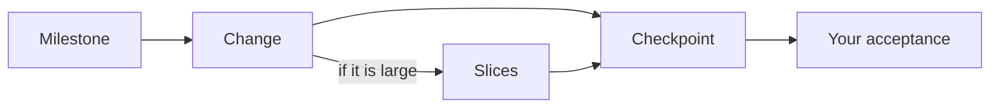

# Overview: Buddy in one page

**The agent knows how to program, but not your process. The library defines the process, and Buddy runs it.**

Buddy is a plugin for Claude Code. When you open Claude Code in a project with Buddy installed, you talk with Buddy. He asks what only you know, has the work built and checked, and brings you only what needs your decision. You never have to type his commands: he runs them. They are in this guide so you can recognise them.

## The shape of the work

- A **milestone** is a delivery of value: a first version, a phase, a proof of concept. It groups changes. You give the go-ahead before it starts.
- A **change** is one thing you asked for: a feature or a planned fix. It has your request in your words, **criteria** (how you will know it is right) and **exclusions** (what it does not include).
- A large change is cut into **slices**. You still accept the change once.
- The **checkpoint** checks each slice: the project's tests, a scan for signs of cheating (a deleted test, a skipped check), and a review by an independent agent. A clean slice asks nothing of you.
- **Acceptance** is yours. Buddy shows you a summary of what was built and how to try it. You accept it, or send it back.

A change of no milestone lives in the backlog. Small corrections (a typo, a quick bug fix) are not changes at all: see [Working alone](working-alone.md).

## Who does what

| Who | What |
| :-- | :-- |
| **You, the owner** | Say what you want and why. Answer the costly questions. Confirm Buddy's assumptions. Accept or send back each change. |
| **Buddy** | Talks with you, in business terms. Keeps the records under `docs/buddy/`. Asks before building what would be costly to get wrong. Raises Dev, runs the checkpoint, prepares what you accept. |
| **Dev** | An agent Buddy raises for one slice. He builds it inside your standards, ticks each step, writes how to try each criterion and commits. He never talks with you. |
| **The independent reviewer** | A read-only agent that sees the work, the criteria and the standards, and says what is not met. It costs a few cents to under a dollar per checkpoint. |
| **The program** | Buddy's own Node program (`buddy <command>`). It writes the records, refuses illegal moves, runs the checks and keeps the evidence. It does not guess. |

**What Buddy does not do for you.** He does not sign, deploy or merge: accepting a change, publishing it and taking it to the main line are your acts. He does not replace the technical peer who reviews the code, nor your organisation's Change Management. The checks help you decide; you answer for the result.

## The cycle of a change

1. You ask for something. Buddy says whether it is a feature, a planned fix or a small correction.
2. Buddy proposes the criteria and exclusions. For a criterion that is vague, that you hesitate on or that can be read two ways, he offers one example that meets it and one that does not; once you confirm them they are written inside the criterion, and Dev's way to try it starts from them. A criterion nobody doubted gets none. He asks the costly questions and says what he will assume. You confirm.
3. The change is made ready. Its goal is now fixed; changing it means going back to refining, and that is your decision.
4. Dev builds it, slice by slice. Each slice goes through the checkpoint.
5. The change is delivered. It waits for you; Buddy goes on with the next one.
6. You try it and accept it, or send it back.

## The library

A **library** is a git repository that holds a process: standards, a base application for each **profile** (a stack), the questions asked when a project is born, and checklists (steps). When you start a project, Buddy copies what the library gives into it. From then on the project owns its copy.

You start with **Buddy's default library**. It has two profiles: `empty` (general standards only) and `dotnet-react` (a .NET API and a React page, each with a first test). Later you may write your own: read the [library guide](../../core/LIBRARY-GUIDE.md).

## Where things live in your project

- `docs/context.md`: why the software exists, who uses it, the constraints, and the risk appetite (what is costly or cheap to get wrong). It is in English unless you chose another language for the documentation; that choice is a line of it.
- `docs/standards/`: the rules the code follows, from the library.
- `docs/inputs/`: what you hand over (a PRD, a prototype). Buddy reads it and never changes it.
- `docs/buddy/`: the milestones, the changes and their evidence. They change only through Buddy's program.
- `docs/decisions/`: the decisions you took, as decision records anyone can read.

Next: [Getting started](getting-started.md).
